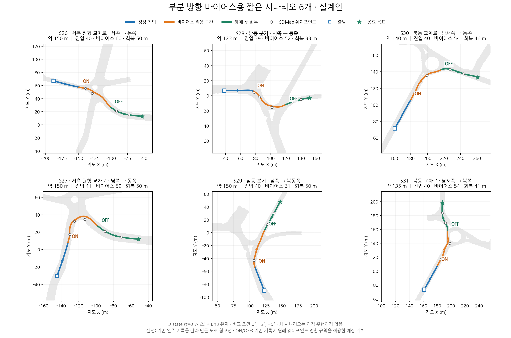

# S26–S31 부분 바이어스 주행 원본 기록 (2026-10-30)

내보낸 범위는 **S26–S31 × 바이어스 −10°·−5°·0° × 각 3회 = 54회**다.
**완주 51회, 경로 이탈 3회**를 모두 포함하며 각 회차의 정지를 확인했다.
하위는 3-state MPC(τ=0.74초, 순수 지연 0초), 상위는 DAQP BnB다.
+5°·+10° 주행 로그는 이번 묶음에 포함하지 않는다.

## 경로 시나리오

웨이포인트 원본, 차량 출발점·방향, C++ 지도 정렬 앵커, 부분 바이어스의
켜짐·꺼짐 구간을 소스와 기록 당시의 세션 스냅샷에 함께 보관했다.
S29는 남쪽에서 북쪽/북동쪽으로 올라가는 경로다.

| 시나리오 | 경로 | 바이어스 waypoint 구간 (1부터, 양끝 포함) | −10° 완주/시도 | −5° 완주/시도 | 0° 완주/시도 |
| --- | --- | --- | --- | --- | --- |
| S26 | 서측 원형 교차로 · 서쪽 → 동쪽 | 3–4 | 3/3 | 3/3 | 3/3 |
| S27 | 서측 원형 교차로 · 남쪽 → 동쪽 | 3–5 | 3/3 | 3/3 | 2/3 |
| S28 | 남동 분기 · 서쪽 → 동쪽 | 4–5 | 2/3 | 2/3 | 3/3 |
| S29 | 남동 분기 · 남쪽 → 북동쪽 | 3–3 | 3/3 | 3/3 | 3/3 |
| S30 | 북동 교차로 · 남서쪽 → 동쪽 | 3–4 | 3/3 | 3/3 | 3/3 |
| S31 | 북동 교차로 · 남서쪽 → 북쪽 | 3–4 | 3/3 | 3/3 | 3/3 |



## 원본 복구와 검증

이 폴더에서 실행한다. 모든 조각을 먼저 받아야 한다. 같은 디렉터리를 원래
워크스페이스에 바로 덮어쓰지 말고 새 복구 디렉터리에 풀어 확인한다.

```bash
sha256sum -c SHA256SUMS
mkdir -p restored
cat scenario_logs.tar.zst.part-* | zstd -dc | tar -xf - -C restored
python3 verify_restored.py restored
```

원본 파일은 `restored/parameter_sweeps/...`, 경로는
`restored/src/virtual_control/data/knu_routes/`에 복구된다.
`original_files.json`은 압축 전 모든 파일의 크기·SHA256이며,
`UPLOAD.json`은 압축 조각과 전체 묶음의 검증 정보다.

19개 원본 세션의 MCAP, 기록 메타데이터, 유효 설정, 토픽 목록, 제어기·기록기 로그,
원본 결과 CSV와 세션 경로 스냅샷을 그대로 보존했다. S30 −5°는 첫 세션의
1회와 이어서 실행한 두 번째 세션의 2회를 합쳐 3회다. 첫 세션에 남은
출발 전 0.017초 중단 기록은 삭제하지 않았으며 54회에는 포함하지 않는다.
`attempt_metrics.csv`의 `run`은 합산 회차이고 `source_run`은 원본 세션 회차다.
`token`으로 원본 CSV·상태 이벤트와 대응할 수 있다.

원래 동결 계획은 +5°·+10°까지 포함한 90회 계획이라 기록 안의 plan에
해당 설정 이름이 등장한다. 실제 압축 원본의 주행 세션은 위 54회에 한정한다.
시나리오 프로필의 `actual_drive_validated=false`는 설계 당시의 동결 메타데이터다.
이를 수정하지 않았으며 이번 실제 주행 결과는 `run_result.json`에 기록했다.

## 결과 해석

경로 이탈 3회도 원본과 집계에 포함했다. 상위 BnB 호출 13,653회에서
상위 solver 실패 판정 158회가 기록됐으며, 실패 때 이전 경로가 유지될 수 있다.
모든 수치 해가 유효하거나 최적이라는 주장은 하지 않는다.
계측 위치·차량 헤딩은 지도에 정렬한 EKF 값이며 SIH 실제 상태와 구별한다.

## 같은 조건으로 새 주행

빌드 후 PX4/프록시와 Isaac BEV 입력을 준비한 환경에서 사용한다.
아래 명령은 로그 재생이 아니라 새 주행을 시작한다.

```bash
bash run_junction_bias.sh 26 27 28 29 30 31 --bias -10 -5 0 --runs 3
```

이번 업로드 준비 과정에서는 새 주행을 시작하지 않았다.
